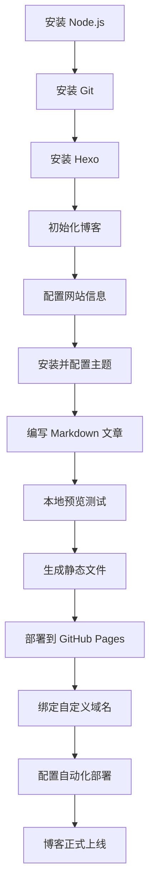

# Hexo 个人网站搭建教程

## 一、Hexo简介

Hexo 是一个快速、简洁且高效的静态博客框架，基于 Node.js 开发。通过 Markdown 编写文章，Hexo 可以快速生成静态网页，并部署到 GitHub Pages、Vercel、Netlify 等平台。

### Hexo特点

* 简单易用
* 支持 Markdown
* 丰富的主题生态
* 快速生成静态页面
* 免费部署

---

# 二、环境准备

在安装 Hexo 前，需要先安装以下软件：

## 1. Node.js

下载地址：

https://nodejs.org

验证安装：

```bash
node -v
npm -v
```

示例输出：

```bash
v22.0.0
10.5.1
```

---

## 2. Git

下载地址：

https://git-scm.com

验证安装：

```bash
git --version
```

示例：

```bash
git version 2.48.1
```

---

# 三、安装Hexo

全局安装 Hexo CLI：

```bash
npm install -g hexo-cli
```

验证安装：

```bash
hexo -v
```

出现版本信息即表示安装成功。

---

# 四、创建博客项目

创建博客目录：

```bash
hexo init my-blog
```

进入项目目录：

```bash
cd my-blog
```

安装依赖：

```bash
npm install
```

---

# 五、项目目录结构

初始化完成后，目录结构如下：

```text
my-blog
├── _config.yml
├── package.json
├── scaffolds
├── source
│   └── _posts
├── themes
└── public
```

目录说明：

| 目录            | 说明       |
| ------------- | -------- |
| source        | 网站源文件    |
| source/_posts | 博客文章     |
| themes        | 主题目录     |
| public        | 生成后的静态文件 |
| _config.yml   | 网站配置文件   |

---

# 六、配置博客信息

编辑根目录下的 `_config.yml`：

```yaml
title: QA Mo Blog
subtitle: 技术分享与生活记录
description: 我的个人博客
author: QA Mo
language: zh-CN
timezone: Asia/Shanghai
```

常用配置：

```yaml
url: https://yourname.github.io

permalink: :year/:month/:day/:title/

theme: landscape
```

---

# 七、创建第一篇文章

创建文章：

```bash
hexo new "我的第一篇博客"
```

生成文件：

```text
source/_posts/我的第一篇博客.md
```

编辑内容：

```markdown
---
title: 我的第一篇博客
date: 2026-05-31 10:00:00
tags:
- Hexo
- Blog
categories:
- 技术
---

欢迎来到我的博客！

这是使用 Hexo 编写的第一篇文章。
```

---

# 八、本地预览

启动本地服务器：

```bash
hexo server
```

或简写：

```bash
hexo s
```

浏览器访问：

```text
http://localhost:4000
```

修改文章后刷新页面即可查看效果。

---

# 九、更换主题

以 Next 主题为例。

## 下载主题

进入 themes 目录：

```bash
cd themes
```

下载主题：

```bash
git clone https://github.com/next-theme/hexo-theme-next.git next
```

---

## 修改配置

编辑根目录 `_config.yml`：

```yaml
theme: next
```

---

## 更新依赖

返回博客目录：

```bash
npm install
```

启动测试：

```bash
hexo clean
hexo g
hexo s
```

---

# 十、部署到GitHub Pages

## 创建仓库

登录 GitHub。

创建仓库：

```text
用户名.github.io
```

例如：

```text
qamo.github.io
```

---

## 安装部署插件

```bash
npm install hexo-deployer-git --save
```

---

## 配置部署

修改 `_config.yml`：

```yaml
deploy:
  type: git
  repo: https://github.com/用户名/用户名.github.io.git
  branch: main
```

例如：

```yaml
deploy:
  type: git
  repo: https://github.com/qamo/qamo.github.io.git
  branch: main
```

---

## 开始部署

清理缓存：

```bash
hexo clean
```

生成静态文件：

```bash
hexo generate
```

部署：

```bash
hexo deploy
```

简写命令：

```bash
hexo clean && hexo g && hexo d
```

---

# 十一、绑定自定义域名

在仓库 Settings → Pages 中配置：

```text
Custom Domain
```

输入：

```text
blog.example.com
```

在 DNS 服务商添加：

```text
Type: CNAME

Host: blog

Value: 用户名.github.io
```

---

# 十二、常用命令

## 新建文章

```bash
hexo new "文章标题"
```

## 新建页面

```bash
hexo new page about
```

## 清理缓存

```bash
hexo clean
```

## 生成静态页面

```bash
hexo generate
```

## 本地运行

```bash
hexo server
```

## 部署网站

```bash
hexo deploy
```

---

# 十三、推荐插件

## 搜索功能

```bash
npm install hexo-generator-searchdb
```

---

## RSS订阅

```bash
npm install hexo-generator-feed
```

---

## 网站地图

```bash
npm install hexo-generator-sitemap
```

---

## SEO优化

```bash
npm install hexo-autonofollow
```

---

# 十四、自动部署GitHub Actions

创建文件：

```text
.github/workflows/deploy.yml
```

内容如下：

```yaml
name: Deploy Hexo

on:
  push:
    branches:
      - main

jobs:
  build:
    runs-on: ubuntu-latest

    steps:
    - name: Checkout
      uses: actions/checkout@v4

    - name: Setup Node.js
      uses: actions/setup-node@v4
      with:
        node-version: 22

    - name: Install Dependencies
      run: npm install

    - name: Generate
      run: npx hexo generate

    - name: Deploy
      uses: peaceiris/actions-gh-pages@v4
      with:
        github_token: ${{ secrets.GITHUB_TOKEN }}
        publish_dir: ./public
```

以后只需：

```bash
git push
```

即可自动部署。

---

# 十五、总结

Hexo 搭建流程如下：



至此，一个完整的 Hexo 个人博客网站已经搭建完成。

建议后续学习：

* Markdown 写作
* Next 主题配置
* GitHub Actions 自动部署
* 评论系统（Giscus、Waline）
* SEO优化
* CDN加速
* 网站统计分析
