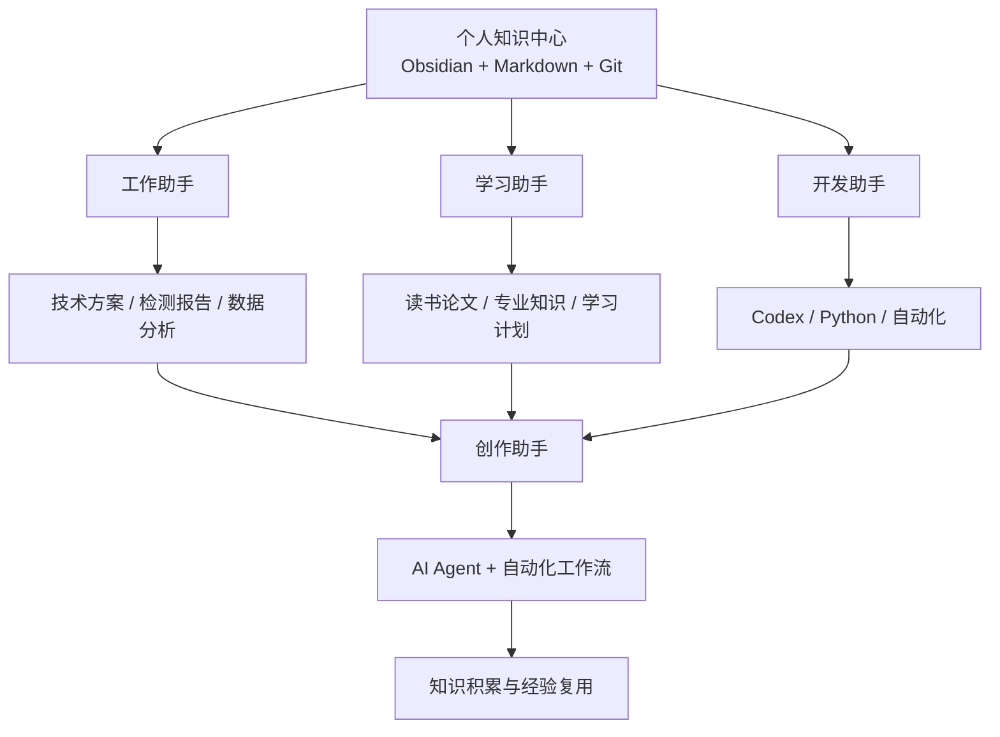

随着人工智能技术的快速发展，AI 正在深刻改变编程、视频制作、内容创作乃至日常工作的方式。

> AI 时代，人与人之间的差距，或许不再取决于谁掌握了更多工具，而在于谁更善于借助 AI 改变自己的思考方式和工作方式。

面对 AI 浪潮，普通人应该如何主动拥抱变化？又该怎样将 AI 真正融入生活与工作，提升效率、拓展能力，甚至改变解决问题的方式？


---

### 一、先理解 AI 能做什么：六个核心能力

想用好 AI，先要知道它到底擅长什么。大致可以归为六类：

| 能力 | 具体能做什么 | 价值 |
| :--- | :--- | :--- |
| 信息获取与整理 | 搜索资料、阅读论文、提炼长文、整理会议记录、比较不同观点 | 减少找信息和读信息的时间 |
| 思考与分析 | 拆解复杂问题、分析利弊、建立逻辑框架、提出多种方案、发现思维盲区 | 提高思考质量，而不只是速度 |
| 内容生产 | 写报告、做 PPT、写方案、写视频脚本、生成图片和设计素材 | 降低表达和创作的成本 |
| 流程自动化 | 自动整理文件、处理 Excel、批量生成文档、执行重复操作 | 让重复劳动逐步自动化 |
| 学习与提升 | 学编程、理解专业知识、模拟面试、练语言、个性化辅导 | 降低学习新知识的门槛 |
| 个人知识管理 | 整理历史资料、记录工作经验、建知识库、调用过往积累 | 让每次学习都留下长期资产 |

理解这六类能力，你才知道在什么场景该找 AI，而不是把它当成万能答案机。

---

### 二、生活中怎么用好 AI

日常生活的很多琐事，都可以交给 AI 辅助。常见场景：

| 场景 | 可以让 AI 做什么 | 价值 |
| :--- | :--- | :--- |
| 学习 | 制定学习计划、解释知识 | 降低学习成本 |
| 阅读 | 总结书籍、分析观点 | 提高阅读效率 |
| 消费 | 比较产品、分析性价比 | 减少冲动消费 |
| 旅行 | 规划路线、预算和行程 | 提高规划效率 |
| 健康管理 | 解释健康知识、整理就诊问题 | 辅助理解，不代替医生 |
| 家庭管理 | 制作采购清单、安排日程 | 减少琐碎事务 |
| 兴趣爱好 | 写小说、做图片、剪视频 | 降低创作门槛 |
| 个人财务 | 整理收支、分析预算 | 提高财务管理能力 |

几个可以直接套用的提问示例：

**场景 1：学一门新技术**

> 我没有编程基础，想学习 Python。请你作为我的私人老师，制定一个 30 天学习计划；每天安排一个学习主题和实际案例；设置练习题；根据我的回答判断我是否真正掌握。

**场景 2：买电子产品**

> 我准备购买一台 Mac 显示器。请从屏幕尺寸和分辨率、色彩表现、接口和供电、使用寿命、价格和性价比等角度分析。请搜索当前市场产品，不要单纯推荐最贵的产品。

**场景 3：读一本书**

> 请帮我深度阅读这本书。不要只做章节摘要，而是提取作者的核心观点、梳理全书逻辑、分析论据是否充分、找出值得质疑的地方、提炼能应用到现实生活的观点，最后形成一篇结构化的 Markdown 笔记。

这里有个原则：**不要只让 AI 给答案，而要让 AI 帮你建立解决问题的方法。** 一个好的提问，会让 AI 变成老师、顾问，而不是复读机。

---

### 三、工作中怎么用好 AI

工作场景是 AI 价值最大的地方，尤其是文字、数据和重复性劳动。

**1. 文档与材料处理**

适合交给 AI 辅助的任务：写工作总结、述职报告；编制技术方案、操作规程；整理会议纪要；优化公文和汇报材料；阅读标准、规范和技术论文；把 PDF 转成结构化 Markdown。

传统方式是`收集资料 → 阅读整理 → 建框架 → 写初稿 → 反复改`；AI 辅助后可以变成`把资料交给 AI 阅读 → 提取核心内容 → 建报告框架 → 写初稿 → 人工审核准确性和结论`。

但要记住一点：**AI 能帮你完成大量文字劳动，但不能替你承担技术责任。**

**2. 数据分析与决策辅助**

AI 可以清洗 Excel 数据、生成统计报表、绘制趋势图、识别异常、建预测模型、分析方案利弊。一个实用的提示词：

> 请分析这份设备检测数据：检查数据完整性；统计各类缺陷数量；分析缺陷分布规律；识别异常数据；生成统计图表；给出可能的原因分析。请区分数据事实和推测，不能根据相关性直接认定因果关系。

涉及工程安全、检测结果或重要经营决策时，一定要回到原始数据和专业标准核实。

**3. 编程与自动化**

| 工作需求 | AI 可以协助实现 |
| :--- | :--- |
| 批量处理文件 | Python 自动化脚本 |
| Excel 数据整理 | 自动清洗、统计、生成报表 |
| 文档转换 | PDF、Word、Markdown 批量转换 |
| 网站建设 | HTML、CSS、JavaScript |
| 知识管理 | 自动分类、索引、搜索 |
| 重复性办公 | 自动化工作流 |

重要的不是学会所有编程语言，而是能描述需求、理解代码逻辑、测试结果，并判断程序是否正确。

**4. 专业能力提升**

AI 还可以扮演专家、评审、项目经理、论文导师或反方专家。比如：

> 你现在是一名管道振动领域的技术专家。我需要研究某管汇的振动响应预测方法。请不要直接给结论，而是依次梳理基础参数、分析可能的激励源、建立理论分析框架、提出计算和仿真方案、分析模型适用条件，并列出需要现场验证的内容。每一步都解释理论依据，并指出目前缺少哪些数据。

这样 AI 就成了你的专业讨论对象，而不是单纯的文字生成器。

---

### 四、让 AI 完成一个完整任务

以写一篇专业技术文章为例，可以拆成七步：

1. **明确目标**：确定主题、读者、用途和交付格式。
2. **收集资料**：搜索论文、标准、技术文档和历史项目资料。
3. **分析资料**：AI 提取观点、整理数据、识别不同观点。
4. **构建框架**：AI 提出结构，由人来确定技术逻辑。
5. **生成初稿**：AI 根据资料和框架撰写。
6. **交叉检查**：检查数据、来源、公式、逻辑和结论。
7. **形成资产**：保存 Markdown，归档资料，沉淀到个人知识库。

真正有价值的，不是 AI 帮你写出一篇文章，而是这次工作**留下了一套以后能复用的方法、资料和经验**。

---

### 五、会提问：五要素方法

不要过度追求**提示词技巧**，把问题说清楚比花哨的模板更重要。推荐用五要素：

| 要素 | 需要说明什么 |
| :--- | :--- |
| 角色（Role） | 希望 AI 扮演什么角色？ |
| 背景（Context） | 目前是什么情况？ |
| 目标（Goal） | 最终想解决什么问题？ |
| 约束（Constraints） | 有哪些限制和要求？ |
| 输出（Output） | 希望得到什么形式的结果？ |

通用提示词模板：

```markdown
# AI 任务说明

## 1. 角色
你需要扮演什么角色？

## 2. 背景
目前的情况、已有资料和相关信息。

## 3. 目标
我希望解决什么问题，最终达到什么效果？

## 4. 约束
时间、预算、技术条件、不能做的事情。

## 5. 输出要求
希望输出什么内容、格式和详细程度？

## 6. 工作方式
先分析问题，再制定方案，分步骤执行。
遇到不确定的信息，先指出，不要自行编造。
完成后检查结果，并说明存在的风险。
```

---

### 六、搭建自己的 AI 工具体系

不用一上来装十几个软件。按用途选工具就够了：

| 工具 | 主要用途 | 定位 |
| :--- | :--- | :--- |
| ChatGPT | 日常问答、资料分析、思考讨论、图片生成、学习辅导 | 综合 AI 助手 |
| DeepSeek | API 调用、长文本分析、代码辅助、自动化应用 | 模型和 API 服务 |
| Codex | 编写程序、修改项目、调试代码、开发自动化工具 | AI 编程代理 |
| Obsidian | 管理 Markdown、建立双向链接、沉淀个人知识 | 个人知识库 |
| n8n | 连接 AI、文件、数据库和应用，实现自动化 | 流程自动化 |

这些工具不需要同时用。**先把 ChatGPT、Codex 和 Obsidian 用熟，再按实际需求增加其他的。**

长期来看，可以把个人知识和工具整合成一个"个人 AI 系统"：



配合一套长期工作循环：

> **发现问题 → 调用 AI → 解决问题 → 验证结果 → 沉淀知识 → 复用经验。**

这套循环一旦建立，AI 才会真正成为个人能力的放大器。

---

### 七、30 天实践计划

每天拿出 30～60 分钟，用 AI 真正解决一个问题，比看十篇教程有用。可以参考下面四周的安排：

**第一周：熟悉 AI**

- 用 AI 解释一个陌生知识点
- 用 AI 总结一篇长文章
- 用 AI 分析一个实际问题
- 用 AI 优化一份工作材料
- 让 AI 从不同角度反驳自己的观点

**第二周：提升工作效率**

- 用 AI 处理一份 Excel 数据
- 用 AI 阅读一份 PDF 技术文档
- 用 AI 编写一份技术方案
- 用 AI 制作一份 PPT
- 用 AI 编写一个简单 Python 脚本

**第三周：建立个人知识库**

- 安装 Obsidian 并建立目录
- 整理 10 份有价值的资料
- 让 AI 自动生成 Markdown 笔记
- 建立知识标签和关联
- 使用 Git 备份知识库

**第四周：实现自动化**

- 使用 Codex 修改一个实际项目
- 建立一个可重复执行的 AI 工作流
- 尝试搭建本地 RAG 知识问答
- 记录 AI 工作流中的错误和改进
- 总结自己的 AI 使用体系

---

### 八、普通人使用 AI 的三个重要判断

**1. 不要把 AI 当搜索引擎**

搜索引擎解决的是"信息在哪里"，AI 更大的价值是帮你理解信息、组合信息、解决问题。

**2. 不要只追求效率，要追求能力的扩展**

AI 不只是让你更快完成原来的工作，也让你能尝试过去没能力完成的事情。

**3. 不要把判断能力交给 AI**

AI 可以生成方案，但你要判断方案是否合理；AI 可以提供结论，但你要核实证据；AI 可以完成任务，但你要对结果负责。涉及资金、医疗、法律、工程安全和个人隐私，更要谨慎。

---

### 写在最后

普通人未来真正的竞争力，不是会不会用某一个 AI 产品，而是能不能形成一套自己的工作方法。

不要盲目追新工具，也不要把 AI 当成无所不能的答案机器。从每天一个真实问题开始，让 AI 帮你完成过去难以完成的事；把有效的方法保存下来，把解决问题的经验沉淀到自己的知识库里。

> 让 AI 帮你做事，让知识帮你成长，让经验在未来持续产生价值。
